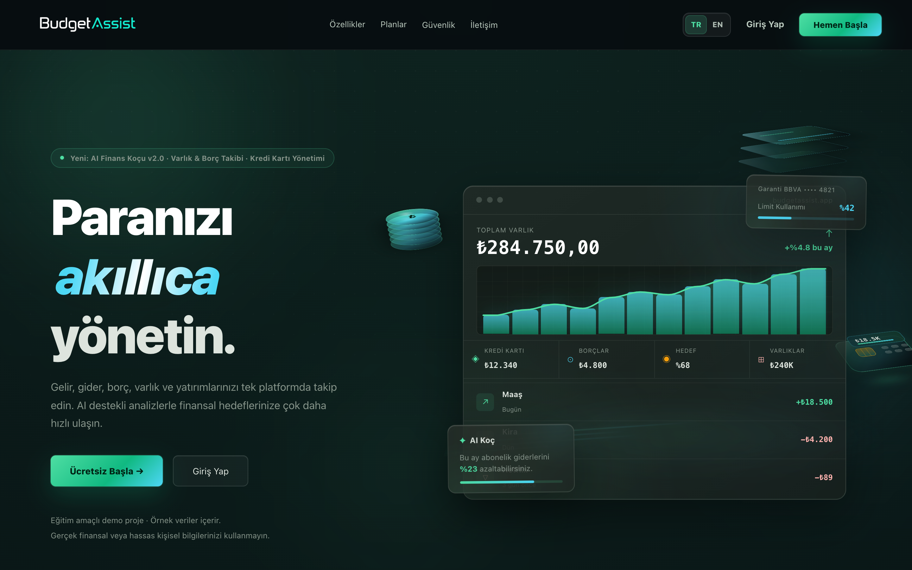
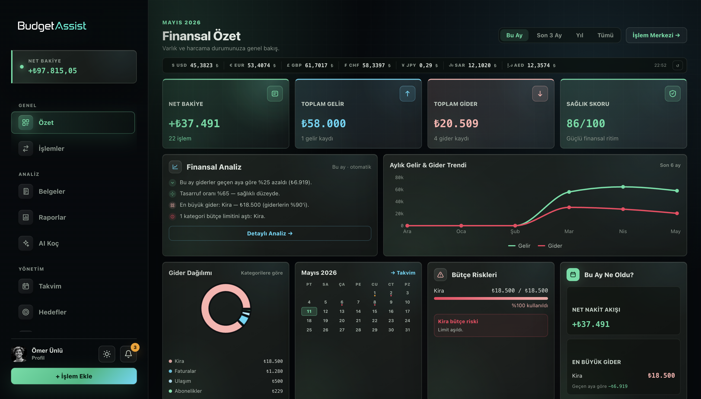
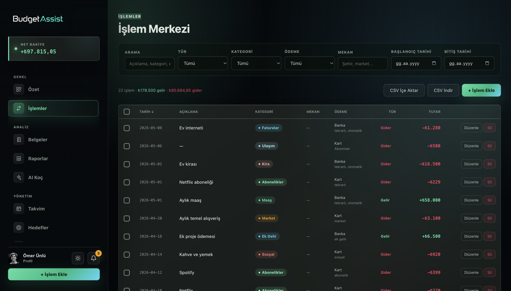
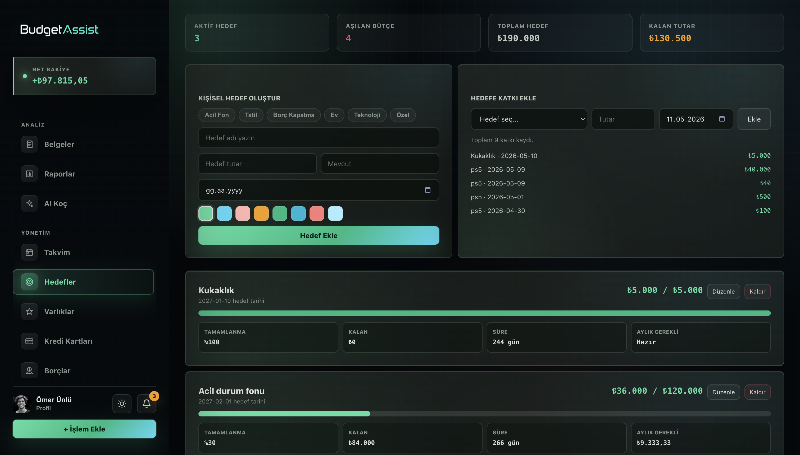
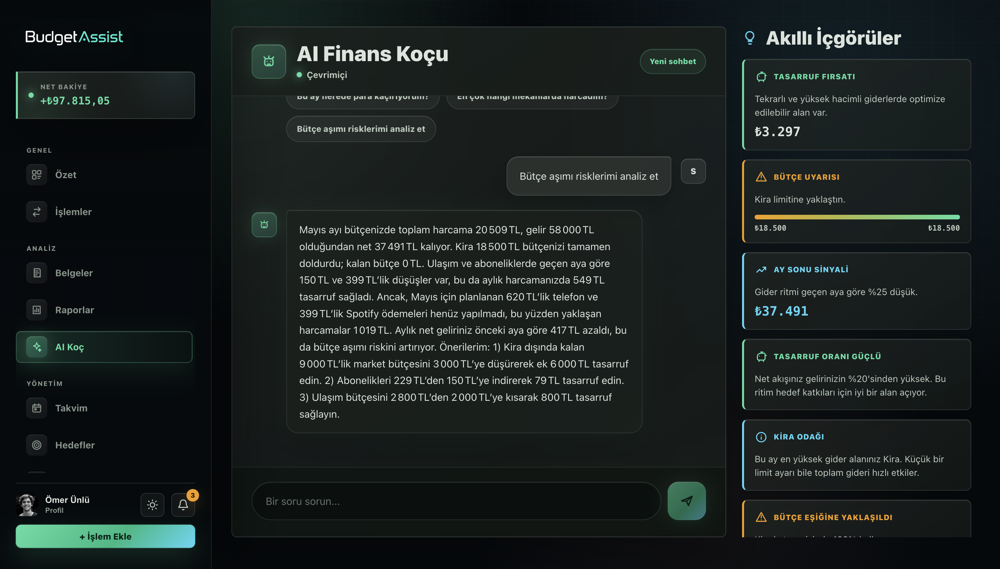
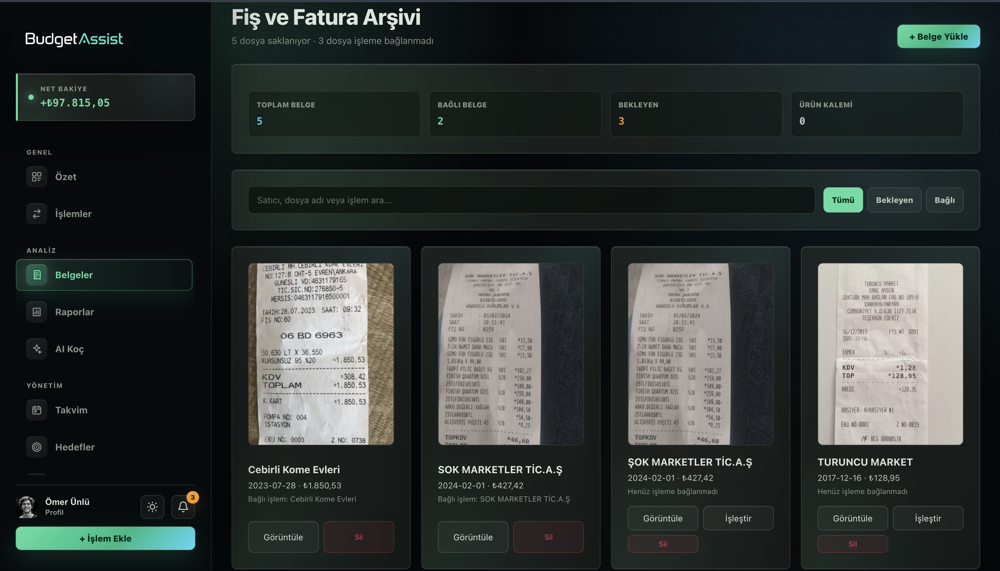
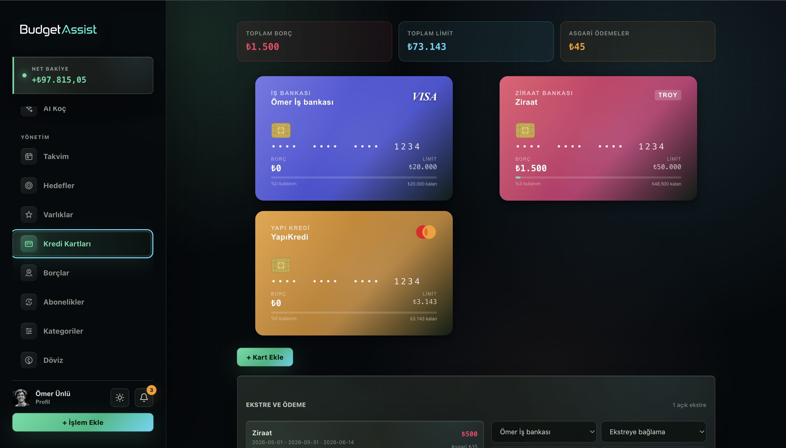
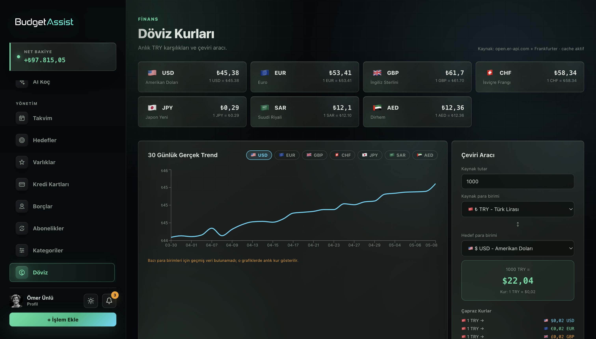

<div align="center">



# BudgetAssist

**Your complete personal finance command center.**

[](https://react.dev)
[](https://vitejs.dev)
[](https://supabase.com)
[](https://vitest.dev)
[](LICENSE)

</div>

---

## Educational Project / Eğitim Projesi

> **TR:** BudgetAssist, yazılım geliştirme ve test süreçlerini uygulamak amacıyla hazırlanmış bir eğitim/ödev projesidir. Ticari bir finans hizmeti değildir. Tanıtım ve demo ekranlarındaki finansal veriler ve kullanım senaryoları örnektir; gerçek kullanıcı referansları veya doğrulanmış performans sonuçları değildir. Gösterilen planlar ve fiyatlar gerçek bir satış teklifini temsil etmez. Uygulamayı denerken gerçek finansal veya hassas kişisel bilgilerinizi kullanmayın.
>
> **EN:** BudgetAssist is an educational/coursework project built to practice software development and testing. It is not a commercial financial service. Financial data and use cases shown in marketing and demo screens are illustrative, not real customer endorsements or verified performance results. Displayed plans and prices are not actual sales offers. Use synthetic test data instead of real financial or sensitive personal information when trying the app.

## Overview

BudgetAssist is a personal finance management application developed as an educational project. Track every transaction, set meaningful financial goals, manage debts and investments, scan receipts with AI-powered OCR, and get personalized advice from a built-in AI Coach — all wrapped in a sleek dark-glassmorphism interface inspired by the **"Quiet Luxury"** design philosophy.

---

## Table of Contents

- [Educational Project / Eğitim Projesi](#educational-project--eğitim-projesi)
- [Implementation & Demo Scope](#implementation--demo-scope)
- [Features](#features)
- [Screenshots](#screenshots)
- [Tech Stack](#tech-stack)
- [Getting Started](#getting-started)
- [Environment Variables](#environment-variables)
- [Project Structure](#project-structure)
- [Design System](#design-system)
- [Testing](#testing)
- [Contributing](#contributing)
- [Security](SECURITY.md)
- [License](#license)

---

## Implementation & Demo Scope

- **Implemented application flows:** Transaction, category, goal, debt, credit-card, and asset management, reports, and CSV import/export are implemented in the source. Account and persistent-data flows require a configured Supabase backend.
- **Configuration-dependent integrations:** AI Coach and receipt OCR require deployed Supabase Edge Functions and a Groq API key. Email/SMS delivery requires the corresponding provider configuration. These integrations are not enabled merely by cloning the repository.
- **Demonstration content:** Landing-page balances, charts, and use cases are sample content. Plan selection demonstrates subscription state; displayed prices do not represent a live checkout or payment service.
- **Concepts and placeholders:** Bank synchronization, live payments, and published mobile applications are outside this repository’s implemented scope.

The feature list below describes the project's implemented and demonstrated scope, not a production service guarantee.

---

## Features

### Core Finance
- **Transaction Management** — Add, edit, delete income and expenses with full filtering, sorting, and CSV import/export
- **Custom Categories** — Create spending categories with icons, colors, and monthly budget limits
- **Budget Tracking** — Real-time budget utilization with visual alerts when limits are approached or exceeded
- **Financial Health Score** — Automated score calculated from your income-to-expense ratio and goal progress

### Planning & Goals
- **Financial Goals** — Set savings targets, track contributions, and visualize progress toward each goal
- **Recurring Rules** — Define templates for repeating transactions (rent, salary, subscriptions) so they auto-populate
- **Budget Calendar** — Monthly calendar view showing transactions plotted on each day for a timeline perspective

### Advanced Tracking
- **Receipt Scanner** — Upload receipt images; AI (Groq/Llama) extracts merchant, amount, date, and category automatically
- **Subscription Manager** — Track recurring subscriptions, see monthly cost totals, and get renewal reminders
- **Debt Manager** — Register debts, log payments, and mark them as settled with a full payment history
- **Credit Cards** — Manage multiple credit cards, track statements, and monitor payment due dates
- **Investment Portfolio** — Add assets (stocks, crypto, real estate), record buy/sell transactions, and capture snapshots over time

### Intelligence
- **AI Coach** — Conversational AI advisor powered by Groq; analyzes your financial data and answers questions about spending, budgeting, and savings strategies
- **Smart Category Suggestions** — Merchant name heuristics auto-suggest the correct category when adding transactions
- **Notification System** — Proactive alerts for budget overruns, upcoming bill due dates, and goal milestones

### Reporting & Export
- **Analytics Dashboard** — Income vs. expense bar charts, category donut charts, monthly trend lines
- **Detailed Reports** — Period-based breakdowns with per-category drill-down
- **Currency Converter** — Real-time exchange rates for multi-currency tracking
- **CSV Export / Import** — Export all transactions or bulk-import from a spreadsheet

### Platform
- **Admin Panel** — Platform-level user management, account suspension, and usage analytics
- **Multi-theme** — Light and dark mode with a single toggle
- **Supabase Auth** — Email/password authentication with user profiles and avatar uploads

---

## Screenshots

### Landing Page


### Dashboard


### Transactions


### Financial Goals


### AI Coach


### Receipt Scanner


### Credit Cards


### Currency Rates


---

## Tech Stack

| Layer | Technology | Version |
|---|---|---|
| UI Framework | React | 18.3 |
| Build Tool | Vite | 8.0 |
| Backend / Auth / DB | Supabase | 2.104 |
| Data Visualization | Recharts | 2.12 |
| AI | Groq — GPT-OSS 20B (Coach), Llama 4 Scout (receipt OCR), configurable via secrets | — |
| Testing | Vitest + Testing Library | 4.1 |
| DOM Environment | jsdom | 29 |
| CI | GitHub Actions | — |

---

## Getting Started

### Prerequisites

- [Node.js](https://nodejs.org) 24 recommended (`.nvmrc` and CI use Node 24); supported engine range: `^22.13.0 || >=24.0.0`
- npm (comes with Node.js)
- A [Supabase](https://supabase.com) test project for authentication and persistent data
- Supabase CLI for deploying optional Edge Functions; PostgreSQL client (`psql`) for database tests

### Installation

```bash
git clone https://github.com/OmerCN1/BudgetAssist.git
cd BudgetAssist
nvm use  # if using nvm; otherwise install Node 24 directly
npm ci
```

### Supabase Setup

1. Create a dedicated test project in Supabase.
2. In **SQL Editor**, run [`supabase/schema.sql`](supabase/schema.sql). This creates the tables, functions, RLS policies, and private `receipts` / `avatars` storage buckets.
3. Run [`supabase/verify_setup.sql`](supabase/verify_setup.sql) to inspect required tables, policies, and functions.
4. In **Authentication → URL Configuration**, add your actual development/deployment URL and allowed authentication redirects. Configure email confirmation for your test environment.
5. Copy the project URL and **publishable / anon** key into `.env.local`. Never put a service-role key in the frontend.

**Existing installations:** apply [`supabase/migrations/202610100001_harden_profile_permissions.sql`](supabase/migrations/202610100001_harden_profile_permissions.sql) to close the profile privilege-escalation path. Updating this repository alone does not patch a hosted database. See [SECURITY.md](SECURITY.md) for the existing-admin review and administrator bootstrap procedure.

### Environment Setup

Copy the example environment file and fill in your credentials:

```bash
cp .env.example .env.local
```

Open `.env.local` and set the required variables (see [Environment Variables](#environment-variables) below).

### Optional AI and Notification Integrations

The landing page can render without Supabase credentials; account and data flows require the backend above.

To enable AI, use the Supabase CLI with **your own test project reference**:

```bash
supabase login
supabase functions deploy ai-coach --project-ref <your-test-project-ref>
supabase functions deploy receipt-scanner --project-ref <your-test-project-ref>
```

In **Supabase Dashboard → Edge Functions → Secrets**, add `GROQ_API_KEY`. Optional overrides are `GROQ_MODEL`, `GROQ_REASONING_EFFORT`, and `GROQ_RECEIPT_MODEL`; see `.env.example`. Keep JWT verification enabled when deploying these functions. Add your frontend origin to the `allowedOrigins` list in each function before deploying to a custom domain.

For notifications, configure `RESEND_API_KEY`, `RESEND_FROM_EMAIL` and/or the Twilio secrets in the dashboard, then deploy `send-notifications` to the same project. Automated delivery is optional: review [`supabase/cron_notifications.sql`](supabase/cron_notifications.sql), configure its settings privately, and apply it only to your own test project. Do not commit filled-in secrets or SQL containing keys.

### Run the Development Server

```bash
npm run dev
```

The app will be available at `http://localhost:5173`.

### Build for Production

```bash
npm run build
npm run preview   # preview the production build locally
```

---

## Environment Variables

| Variable | Required | Description |
|---|---|---|
| `VITE_SUPABASE_URL` | Yes | Your Supabase project URL (e.g. `https://xxxx.supabase.co`) |
| `VITE_SUPABASE_PUBLISHABLE_KEY` | Yes | Your Supabase `anon` public key |
| `GROQ_API_KEY` | Optional | Groq API key — enables AI Coach and Receipt OCR (set as a Supabase Edge Function secret, not in `.env.local`) |
| `RESEND_API_KEY` | Optional | [Resend](https://resend.com) API key — enables email notifications |
| `TWILIO_ACCOUNT_SID` | Optional | Twilio SID — enables SMS notifications |
| `TWILIO_AUTH_TOKEN` | Optional | Twilio auth token |
| `TWILIO_FROM_NUMBER` | Optional | Twilio sender phone number |

> **Security note:** `GROQ_API_KEY`, `RESEND_API_KEY`, and Twilio secrets should be stored as **Supabase Edge Function secrets**, not in your frontend `.env.local` file.

---

## Project Structure

```
BudgetAssist/
├── public/                  # Static assets
├── src/
│   ├── components/          # Feature modules (one folder per feature)
│   │   ├── dashboard/       # Overview charts & health score
│   │   ├── transactions/    # CRUD + CSV import/export
│   │   ├── categories/      # Custom categories with budgets
│   │   ├── goals/           # Financial goals & contributions
│   │   ├── reports/         # Analytics & period reporting
│   │   ├── calendar/        # Transaction calendar view
│   │   ├── receipts/        # OCR receipt scanning & archive
│   │   ├── subscriptions/   # Recurring payment tracker
│   │   ├── debts/           # Debt & payment management
│   │   ├── creditcards/     # Credit card statements
│   │   ├── assets/          # Investment portfolio
│   │   ├── coach/         # Conversational AI advisor
│   │   ├── currency/        # Real-time exchange rates
│   │   ├── notifications/   # Alert center
│   │   ├── recurring/  # Recurring transaction templates
│   │   ├── account/         # User profile & avatar
│   │   ├── admin/           # Platform administration
│   │   ├── auth/            # Login & registration
│   │   ├── plans/           # Subscription tiers
│   │   └── ui/              # Shared UI primitives (Card, Modal, etc.)
│   ├── hooks/
│   │   ├── useAuth.js       # Authentication state
│   │   └── useTheme.js      # Light/dark theme
│   ├── services/
│   │   ├── budgetService.js # Core finance operations (Supabase)
│   │   ├── assetService.js  # Portfolio & asset data
│   │   ├── currencyService.js
│   │   ├── notificationService.js
│   │   └── adminService.js
│   ├── utils/
│   │   ├── finance.js       # Health score, totals, category math
│   │   ├── categorySuggestions.js
│   │   └── helpers.js
│   ├── App.jsx              # Root component & router
│   └── main.jsx             # Entry point
├── supabase/
│   ├── schema.sql           # Complete setup for a fresh Supabase project
│   ├── migrations/          # Incremental updates for existing installations
│   ├── tests/               # PostgreSQL authorization regression suite
│   └── functions/           # AI and notification Edge Functions
├── docs/
│   ├── screenshots/         # Application screenshots
│   ├── test-plan.md
│   ├── test-cases.md
│   └── test-summary.md
├── DESIGN.md                # Full design system reference
├── .env.example             # Environment variable template
└── package.json
```

---

## Design System

BudgetAssist uses the **"Luminous Wealth"** design language — a dark glassmorphism aesthetic that conveys sophistication without noise.

| Token | Value | Usage |
|---|---|---|
| Emerald `#4edea3` | Primary | Growth, positive cash flow |
| Cyan `#4cd7f6` | Secondary | Savings, investments |
| Rose `#f43f5e` | Danger | Expenses, over-budget |
| Amber `#f59e0b` | Warning | Alerts, near-limit |
| Navy `#05090d` | Background | App canvas |

- **Typography:** System UI sans-serif (UI text) · system monospace (financial data); see `src/constants/theme.js`
- **Layout:** 8 px grid, generous whitespace, translucent glass cards with subtle luminescent borders
- **Motion:** Smooth transitions on all interactive elements

For the full specification see [DESIGN.md](DESIGN.md).

---

## Testing

```bash
npm test               # watch mode
npm run test:run       # single run (CI)
npm run test:coverage  # coverage report
npm run test:ui        # Vitest UI dashboard
```

Tests cover financial calculation utilities and React component logic. See the full test documentation:

- [Test Plan](docs/test-plan.md)
- [Test Cases](docs/test-cases.md)
- [Test Summary](docs/test-summary.md)

CI runs on pushes to `main` / `develop` and pull requests targeting `main`. It checks unit tests, CLI safety tests, coverage, builds, and database profile permissions.

### Database Permission Tests

Run against an **empty, disposable PostgreSQL 17 database**, using its `postgres` owner:

```bash
TEST_DATABASE_URL='postgresql://postgres@localhost:5432/budgetassist_test' npm run test:db
```

The suite creates minimal Supabase auth/storage fixtures, tests both fresh setup and an upgrade from the old profile permissions, applies the profile upgrade twice, and checks RLS, privileged-field inserts/updates, profile deletion, ban reset attempts, and legitimate admin operations. All changes roll back. Do not point this test at a hosted project or a database containing real data. CI provisions its own PostgreSQL service.

### Test Users and Load Tests

Test account creation requires explicit `SUPABASE_URL`, `SUPABASE_SERVICE_ROLE_KEY`, and `TEST_USER_PASSWORD` environment variables. The password must be at least 12 characters; there is no shared default or command-line password option. Set secrets privately in your terminal/environment, not in source files or shell commands you publish.

```bash
npm run create:test-users -- --dry-run --count 2  # no credentials or network needed
npm run create:test-users -- --count 2           # requires the environment above
npm run test:scripts
```

Load testing requires an explicit target (`--host` or `SUPABASE_URL`); no hosted project is selected by default. Use only an isolated environment you own or have permission to test. Authenticated load scenarios can invoke paid AI and notification providers.

```bash
python3 -m venv .venv
.venv/bin/pip install locust
.venv/bin/locust -f locustfile.py --host=https://your-test-project.supabase.co
```

Provide `SUPABASE_ANON_KEY` (or `VITE_SUPABASE_PUBLISHABLE_KEY`) and synthetic account credentials through `SELENIUM_TEST_EMAIL` / `SELENIUM_TEST_PASSWORD` for authenticated scenarios. Reports in `docs/` are historical test artifacts, not current availability or security guarantees. Example hostnames in the text have been generalized for reuse.

---

## Contributing

1. Fork the repository
2. Create a feature branch: `git checkout -b feat/your-feature`
3. Commit your changes: `git commit -m "feat: add your feature"`
4. Push to the branch: `git push origin feat/your-feature`
5. Open a Pull Request

Please follow the existing code style and add tests for any new logic.

---

## License

This project is licensed under the [MIT License](LICENSE).

---

<div align="center">
Built for learning, testing, and exploring personal finance interfaces.
</div>
